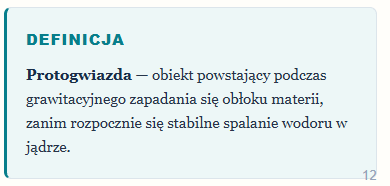
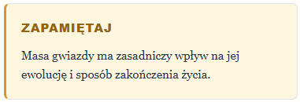
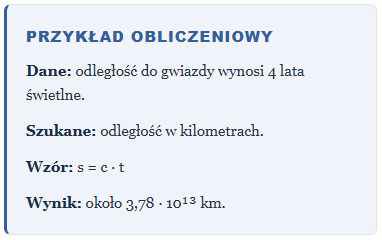

# Stylowanie podręcznika - użyteczne klasy

## Strona rozdziału

## Bloki

`<div class="textbook"></div>` - .textbook sam z siebie nic nie robi. Potrzebuje jeszcze klasę helperową

### Definicja

`class="definition"`



```html
<div class="textbook-box definition">
  <p class="box-label">DEFINICJA</p>
  <p>
    <strong>Protogwiazda</strong> — obiekt powstający podczas grawitacyjnego
    zapadania się obłoku materii, zanim rozpocznie się stabilne spalanie wodoru
    w jądrze.
  </p>
</div>
```

### Ciekawostka

`class="curiosity"`


```html
<div class="textbook-box curiosity">
  <p class="box-label">✦ CZY WIESZ, ŻE…?</p>
  <p>Światło Słońca dociera do Ziemi w około 8 minut i 20 sekund.</p>
</div>
```

### Zapamiętaj

`class="remember"`



```html
<div class="textbook-box remember">
  <p class="box-label">ZAPAMIĘTAJ</p>
  <p>
    Masa gwiazdy ma zasadniczy wpływ na jej ewolucję i sposób zakończenia życia.
  </p>
</div>
```

### Przykład

`class="example"`



```html
<div class="textbook-box example">
  <p class="box-label">PRZYKŁAD OBLICZENIOWY</p>
  <p><strong>Dane:</strong> odległość do gwiazdy wynosi 4 lata świetlne.</p>
  <p><strong>Szukane:</strong> odległość w kilometrach.</p>
  <p><strong>Wzór:</strong> s = c · t</p>
  <p><strong>Wynik:</strong> około 3,78 · 10¹³ km.</p>
</div>
```

## Highlights

`<span class="highlight">około 8 minut i 20 sekund</span>`

# Dokumentacja Prawidłowa

## 1. Wczytywanie treści podręcznika

Treści wszystkich podręczników są zapisane w folderze `content\books\` w formacie `.mdx`. Złożone są z dwóch elementów:

### 1.1. Dane

Zapisane w `booksCollection`:

```javascript
const booksCollection = defineCollection({
  loader: glob({
    pattern: "**/[^_]*.{md,mdx}",
    base: "./src/content/books",
  }),
  schema: z.object({
    title: z.string(),
    subtitle: z.string().optional(),
    subject: z.string(),
    grade: z.string(),
    bookType: z.string().default("Podręcznik"),
    frontPageImageSrc: z.string().optional(),
    slug: z.string(),
    chaptersPages: z
      .array(
        z.object({
          name: z.string(),
          page: z.number().int().positive(),
          subchapters: z
            .array(
              z.object({
                name: z.string(),
                page: z.number().int().positive(),
              }),
            )
            .optional(),
        }),
      )
      .optional(),
  }),
});
```

Przykład użycia:

```javascript
title: "Astronomia: Światła Wszechświata"
subtitle: "Gwiazdy, Galaktyki i Wszechświat"
subject: "Astronomia"
grade: "3"
bookType: "Podręcznik"
frontPageImageSrc: "https://www.nasa.gov/wp-content/uploads/2015/10/oct_1_2015_flare.jpg"
slug: "astronomia-swiatla-wszechswiata-3"

chaptersPages:
  - name: "Słońce i podstawy fizyki gwiazd"
    page: 1
    subchapters:
      - name: "2.1. Słońce - nasza najbliższa gwiazda"
        page: 2
```

### 1.2. Kontent

Zapisany w postaci MarkDown + HTML. Treść dzieli się na strony **ręcznie** za pomocą separatorów `---`.

**Ważna uwaga**: początkowy blok otoczony musi być `--- ---`. Te dwa separatory **nie dzielą** stron. Dopiero następne są wczytywane i wykorzystywane przez kod.
